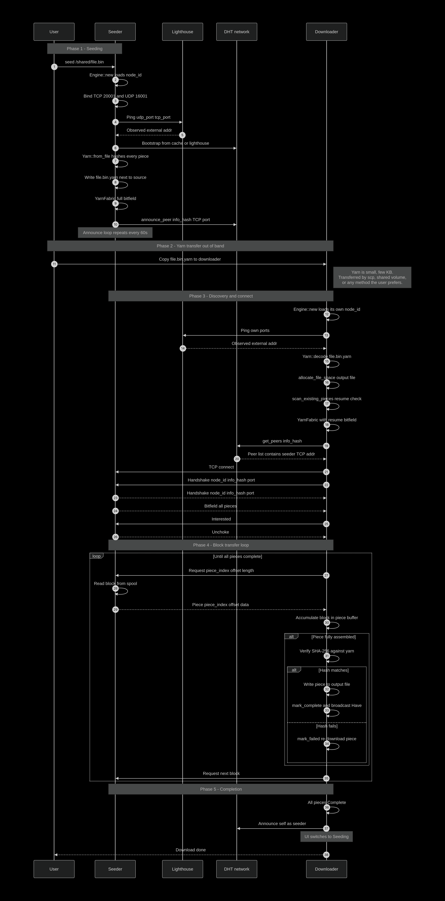

# PodWeaver

*All are friends of the PodWeaver swarm.*

PodWeaver is a decentralised peer-to-peer file-sharing platform. The application provides a simple GUI for uploading and downloading files, backed by a custom wire protocol and a lightweight API. It is not a BitTorrent client — the protocol is purpose-built, and the design favours clarity over compatibility with existing swarms.

## Build

## Architecture

PodWeaver follows a strict hierarchical division of tasks. Each instance combines a Kademlia DHT, a peer discovery subroutine, persistent storage handlers, a runtime manager, and a `Yarn` constructor.

    

### Modules

| Module | Responsibility |
|---|---|
| `dht` | Kademlia routing table, KRPC messages, peer store, token store |
| `transport` | Incoming UDP network messages, pending-query map, transaction IDs |
| `peer` | Peer wire protocol, connection lifecycle, choking, PEX, piece manager |
| `yarn` | Bencode codec, torrent metadata, piece length calculation |
| `storage` | Atomic disk writes, spooled reads/writes, peer cache |
| `runtime` | Tokio task tracking, cancellation, graceful shutdown |
| `ui` | Axum HTTP server, SSE progress stream, per-torrent state |
| `lighthouse` | Standalone tracker binary (not part of PodWeaver) |

Every file a user shares or downloads is bound to its `Yarn` metainfo dictionary. The yarn is the global key that identifies that file across the network. Each yarn carries a list of piece hashes covering the entire file. Piece length is variable and derived from the total file size, but data is always transferred in blocks of 16 KiB.

## Single Yarn Lifecycle

A yarn file is the unit of sharing in PodWeaver. It carries the metadata needed to find, verify, and reconstruct a single file: the info hash that identifies it on the DHT, the piece length that determines how the file is chunked, and a SHA-256 hash for every piece. Producing and consuming a yarn are the two halves of the system's purpose.

    

The lifecycle has five phases.

- **Seeding.** The seeder hashes every piece of the source file, selects a piece length based on the file's total size, and writes a `.yarn` file alongside the original. It then registers the info hash with the DHT, announcing the TCP port it listens on. An announce loop repeats this every sixty seconds to keep the entry fresh — without it, the DHT would forget the peer after thirty minutes.

- **Yarn transfer.** The `.yarn` file is small — a few kilobytes regardless of the source file's size — and is deliberately never fetched over the network. It moves between peers the same way a `.torrent` file does: over SSH, a shared volume, a chat message, or whatever the user prefers. This is what makes the network uncrawlable. A node can only discover peers for an info hash it already knows.

- **Discovery.** The downloader decodes the yarn, pre-allocates the output file at the correct size, and scans whatever bytes are already on disk. Any piece whose SHA-256 matches the yarn is marked complete — this is what makes resume work. The downloader then queries the DHT for peers serving that info hash and receives a list of TCP addresses.

- **Transfer.** The two peers exchange handshakes, bitfields, and interest flags, then settle into a request-and-serve loop. The downloader requests one 16 KiB block at a time; the seeder reads it from its spool and returns it. Once every block of a piece has arrived, the downloader hashes the assembled piece and writes it to disk if the hash matches. A mismatch marks the piece failed and triggers a full re-download of that piece.

- **Completion.** Once every piece is verified, the downloader's bitfield is full. The announce loop it has been running since Discovery is already advertising it as a peer for that info hash, so it begins serving requests from other downloaders immediately — without any role change or explicit promotion. The only difference between a seeder and a downloader in PodWeaver is the bitfield they start with.

## State Machines

PodWeaver relies heavily on asynchronous, parallel state machines to refresh and maintain coherent state across all modules. Every submodule is atomic and unaware of the others' existence; several state machines work together to integrate them and prevent deadlocks.

### Connection Lifecycle

A connection begins in `New` and immediately transitions to `Handshaking`, where both sides exchange their node ID, info hash, and listen port. If the handshake fails — timeout, wrong info hash, or a peer that turns out to be ourselves — the connection moves to `Failed` and tears down. A successful handshake produces a `Registered` connection: the peer has been added to the choke manager's table, the router has a channel to deliver messages to it, and its listen address has been shared with the PEX pool so other pods can discover it.

From `Registered`, the connection enters `Active`, the long-lived state where every application-level message is handled — requests, pieces, chokes, unchokes, bitfield updates, and PEX gossip. `Active` is exited by any of five triggers: a clean EOF on the socket, the fabric's cancel token firing, a 30-second read timeout, a 120-second idle timeout, or a handler error. All five lead to `Closing`, where the same cleanup runs regardless of which trigger fired. Every block the connection had in flight is released by calling `cancel_request` for each entry, then the in-flight map is cleared. The router unregisters the peer, the choke manager drops it, and the write task is aborted. Without the in-flight release, a peer that disconnects mid-transfer would leave its entries in `requested_from` forever, and those blocks would become unassignable — a silent stall in the final pieces of a download.

### Block State

The atomic unit of transfer, 16 KiB. A block's state lives inside `PieceStatus::InFlight` as two parallel vectors on the parent piece: `blocks[i]: Option<Vec<u8>>` holds the data once it arrives, and `requested_from[i]: Vec<SocketAddr>` tracks which peers have been asked.

A block starts `Unrequested` when its parent piece moves from `Missing` to `InFlight`. The first `mark_requested` pushes a peer onto `requested_from[i]` and moves the block to `Requested`. A second `mark_requested` from a different peer — only possible in endgame mode — adds a second requester without changing the state. When the block's data arrives, `record_block` sets `blocks[i] = Some(data)`, clears `requested_from[i]` down to the peer that sent it, and moves the block to `Received`.

The reverse transition fires whenever every requester is removed from `requested_from[i]` — through a 30-second response timeout, through a connection drop, or through a `Cancel` sent during endgame. Once a block is `Unrequested` again, `choose_block` will hand it to the next peer that asks.

### Piece Lifecycle

`PieceManager.piece_state` holds one `PieceStatus` per piece, and it is the only state shared between every connection serving the same torrent. A piece starts `Missing`, or `Complete` if it was marked so by a resume scan or a seeder's full bitfield. The first `mark_requested` for any of its blocks moves it to `InFlight`, at which point `blocks` is sized to the correct number of 16 KiB chunks for that piece's length.

When every block has arrived, `record_block` assembles the piece bytes and returns them to the caller, who hashes the result against the yarn's expected hash. A match calls `mark_complete`, which flips the piece to `Complete` and sets its bit in the global bitfield. A mismatch calls `mark_failed`, which drops the piece back to `Missing`, discards every block it had collected, and adds the reporting peer to a per-piece blocklist so it cannot serve the same piece again.

A connection drop does not formally change the enum — it removes the departed peer from every `requested_from` list across the piece's blocks. But if that leaves a piece with no outstanding requests and no data, the piece behaves exactly as if it were `Missing`: `choose_piece` will return it, and the next block request starts the cycle again.

### Blocklist

Every `PieceManager` maintains a `failed_peers: Vec<HashSet<SocketAddr>>`, one set per piece. When a piece fails its SHA-256 check, the peer that provided the bad data is added to that piece's set. `choose_piece` refuses to return any piece whose only available sources are blocklisted, and when a piece is retried, the requesting side filters blocklisted peers out of the candidate list. The blocklist is per-piece rather than global: a peer that corrupts one piece is still trusted for the others, because the alternative — banning them entirely — is more likely to be a false positive than a real attack.

### Choking

Many peers misbehave and exploit the download rate of their fellow pods. A `ChokeManager` runs a state machine to limit the swarm to the most useful and fair peers. Every 10 seconds the choke scheduler re-evaluates every connected pod, measuring each one's download rate since the last evaluation and adjusting which peers are unchoked. Only the fastest N peers remain unchoked at any given time; the rest are choked, which prevents the swarm from being flooded with requests from peers that are not contributing back.

Every 30 seconds, a separate timer fires an optimistic unchoke: a randomly-selected choked peer is temporarily promoted to unchoked for the duration of the interval. This gives new connections a chance to prove themselves without waiting for the rate-based scheduler to notice them. If the optimistic peer can beat the current unchoked set's download rate, it will eventually replace the slowest member. If it cannot, it is re-choked when the interval expires, and a new random peer is promoted.

The four flags per peer — `am_choking`, `am_interested`, `peer_choking`, `peer_interested` — are set independently. Interest transitions fire on the four protocol messages and on `maybe_send_interested`, which recomputes from the comparison between our bitfield and theirs. Choking transitions fire only on the scheduler's own timers.

### Endgame Mode

Not a stored state. Derived on every pipeline refill from `pm.is_endgame()`, which is simply `bitfield.missing() <= 6`. When false, `choose_piece` and `choose_block` only return blocks with empty requester lists — one peer per block. When true, both allow duplicates: `choose_piece` will select a piece whose blocks are all already requested, and `choose_block` picks the block with the fewest outstanding requesters, skipping any block this peer has already asked for.

Duplicate requests are resolved by `record_block`, which returns a list of every requester that lost the race. The winner's connection sends each loser a `Cancel`, and the losers remove the requester from their local tracking. A late `Piece` message arriving after a `Cancel` is dropped by the duplicate-block check at the top of `handle_piece`.

Because there is no state to enter or exit, there is nothing to keep in sync. The mode is a pure function of the current bitfield, re-evaluated sixteen times a second during active transfer.

### Rate Limiter

One token bucket per connection, present only when `DOWNLOAD_RATE` is set. Two states: has budget, and empty. The bucket refills continuously from wall-clock elapsed time and is capped at one second's worth of budget. `try_consume(n)` either deducts `n` and returns true, or leaves the bucket unchanged and returns false.

The subtlety is in the caller: `refill_pipeline` must sleep for `time_until(n)` and retry rather than breaking out of its loop, otherwise the effective rate is bounded by the pipeline refill tick rather than by the configured value. The bucket is per-connection, not per-torrent, so a downloader connected to multiple seeders will see its total bandwidth scale with the number of connections.

### Torrent State

Held across two maps in `AppState`. A torrent is either in `active` — with a live `YarnFabric`, running connections, and an announce loop — or in `paused`, with its `Yarn` and cached `Bitfield` retained but no runtime resources.

`add_seed` and `add_download` create the fabric and insert into `active`. `pause_torrent` removes it, caches the current bitfield, cancels the fabric's cancel token, and calls `pod_manager.remove_yarn` to drop it from the routing table. Every connection belonging to that fabric exits on the next cancel-token check, releasing its in-flight blocks as it goes. `resume_torrent` rebuilds a fresh fabric from the cached bitfield — or, if the process restarted and the cache is gone, from a disk rescan via `scan_existing_pieces` — then calls `add_yarn` and spawns a new announce loop. `remove_torrent` performs the same teardown as pause and drops the entry from whichever map it was in; the output file is deliberately left on disk.

The UI-visible states — `Downloading`, `Seeding`, `Paused`, `Removed` — are derived from `progress()` and `is_paused` on each snapshot, not stored. There is no explicit promotion from downloader to seeder: a torrent that reaches 100% simply starts being reported as seeding.

### Announce Loop

One spawned task per active fabric. It runs `iterative_lookup_and_announce` immediately, then repeats every sixty seconds until the fabric's cancel token fires. Each iteration transitions through three states. In `Idle` the loop waits on the ticker. On tick it moves to `Lookup`, which runs the full iterative query — up to twenty nodes visited, three queried in parallel per round, sorted by XOR distance to the target.

The lookup either returns a set of peers with announce tokens, or it returns nothing because the routing table is empty. In the first case the loop moves to `Announcing` and sends an `announce_peer` to the eight closest nodes that provided tokens. In the second it moves to `Rebootstrapping`, which re-queries the lighthouse for seed nodes and re-runs `dht.bootstrap` before returning to `Idle` — this is what keeps a node from going permanently mute when its routing table drains.

### DHT Node Lifecycle

The top-level state of `DHT::run`. `Uninit` moves to `Bootstrapping`, which pings up to ten seed nodes in parallel and then runs an iterative `FindNode` for the node's own ID to populate the buckets nearest to itself. A successful bootstrap moves to `Active`, the message pump. `Maintenance` fires on the periodic tick and refreshes stale buckets by pinging every `Questionable` or `Bad` node, then rotates the token secret generation. `Shutdown` is triggered by the root cancel token and stops everything in one step.

### Message Pump

What `DHT::run` does while `Active`. The loop is an `Idle` state that wakes on four events: an inbound query from the transport, an outbound query initiated by the application, a maintenance tick, or cancellation.

An inbound query decodes via `krpc`, dispatches by type, and replies. Every one of the four query types — `Ping`, `FindNode`, `GetPeers`, `AnnouncePeer` — updates the routing table with the sender's address before responding. `GetPeers` additionally consults the peer store and issues a fresh token bound to the sender's IP. `AnnouncePeer` verifies the token before writing to the peer store and silently drops the query if the token is invalid.

An outbound query reserves a transaction ID, inserts a oneshot sender into the pending map, sends the datagram, and waits. When the matching response arrives, the pending map resolves the sender and the caller wakes up. If three seconds pass without a match, the sender is dropped and the caller sees a timeout error. Responses bearing an unknown transaction ID are silently discarded, which is what makes a stale reply arriving after its own timeout harmless.

### Routing Table Node Status

Every entry in `routing.rs` carries a status computed lazily from `last_seen`. A fresh insert is `Good`. Fifteen minutes without a successful response moves it to `Questionable`. Thirty more minutes moves it to `Bad`. Any successful response at any point resets the timer and returns the node to `Good`. A `Bad` node is evicted when its bucket needs to make room for a new insertion.

### KRPC Transaction

The short-lived state machine of a single query-response pair, tracked in `PendingMap`. A transaction is `Building` while the query payload is encoded, `Sent` once the datagram is on the wire and the oneshot sender has been inserted into the map, and `Waiting` while the three-second timeout is armed. When a matching response arrives, the map entry is removed and the sender is fired, transitioning to `Matched`. When the timeout elapses, the entry is removed and the sender is dropped, transitioning to `TimedOut`. A response whose transaction ID is not in the map — because the original already timed out, or because it belongs to another node — is dropped without state change.

### Peer Store Entry

Per `(info_hash, peer_addr)` pair, held in `peer_store.rs`. An entry starts `Fresh` on first `announce_peer` with a thirty-minute TTL. Re-announcement from the same peer refreshes the TTL; `get_peers` reads do not. Once the TTL elapses, the entry is `Expired` and will be removed the next time a read encounters it — there is no background sweeper. When the store reaches its cap of one hundred peers for a given info hash, the oldest entry is evicted to make room for a new one, by insertion time rather than by last access.

### Token Lifecycle

Held in `token_store.rs`. Tokens are how `announce_peer` is authenticated — without them, any node could poison the peer store with arbitrary addresses. Three generations of secrets are kept live at once. A freshly issued token is signed against the current secret and starts in `Current`. Every ten minutes the secret rotates: `Current` becomes `Previous`, and a new secret is generated as `Current`. Tokens from `Previous` are still accepted during the grace window, which is what prevents a token issued five seconds before rotation from failing. Two rotations later, the oldest secret is discarded and any token derived from it moves to `Expired` — verification fails and the query is silently dropped.

Because tokens are bound to the sender's IP address via `SHA-256(secret || ip)`, a token issued for one peer cannot be replayed from another.

### Lighthouse Registry Entry

Held by the standalone lighthouse binary. A source IP enters the registry via an `OP_PING` carrying both the node's UDP and TCP ports. If the IP is already present, the entry is refreshed rather than duplicated. If the registry is at its cap of twenty nodes and the IP is new, the insertion is rejected and the node must retry.

Every 120 seconds the lighthouse sweeps the registry, opening a TCP connection to each entry's *TCP* port with a three-second timeout. A successful connect keeps the entry; a failure evicts it. The critical detail is that the sweep probes TCP and not UDP — the UDP port is what gets handed back to bootstrapping nodes and cannot be probed with a TCP connect. Using the wrong port for the sweep causes every node to be evicted every two minutes and the registry to stay effectively empty.

### Engine Startup

Not a struct, but a fixed sequence worth naming. `Engine::new` moves through `LoadOrCreateID` — reads or generates `node_id.silk` — through `BindTCP` (pod manager listening on port 20001), `BindUDP` (transport on port 16001), `DHTInit` (transport and DHT run loops spawned), `LighthousePing` (external address learned and registration sent), `CacheCheck` (peer cache read from disk), and `Bootstrap` (DHT seeded from cache or lighthouse). The engine returns to the caller in `Ready`, then runs as `Running` until `shutdown` is called, which saves the peer cache, cancels the root token, and waits up to two seconds for tracked tasks to drain.

## Known Limitations

 - Piece and block selection picks simply the first missing piece/block instead of searching for more appropriate options like rarest-first or closest-first.
 - PodWeaver can only function on public IPs, any node behind NAT is closed off to the swarm.
 - Incase of an empty peer cache, the runtime is crippled and depends entirely on a centra bootstrap server.

