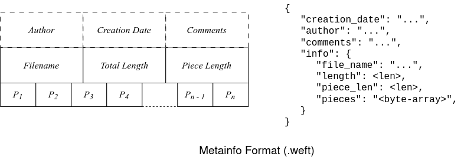
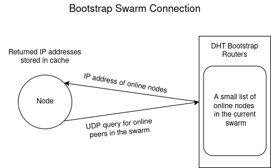

# High-Level Design Documentation

This document is a detailed overview of the general workings of PodWeaver, it establishes the algorithms used and the tools that enable two peers to share files from boot to disconnection.

## 1: Metainfo generation

Any file that is uploaded to or downloaded from the swarm needs a metainfo file which provides additional information. The metainfo file must include a byte array of SHA-256 hashed pieces. Pieces are subunits of the actual file divided into equal sized chunks. Along with the byte array, metainfo can hold additional data like time of upload, name of the creator, name of the file, size of the file, length of each piece, etc. Some of the fields like time of upload and name of creator are optional. 

The metainfo file is represented as a dictionary, the dictionary must contain a sub-dictionary with key `info`, any additional optional information is stored along side the `info` dictionary.

Entries in the dotted boxes here represent optional fields.

    

### 1.1 Information encoding

The generated metainfo for each file that will be shared is needed by all peers that wish to download the it, therefore it must stored in a standardised format readable by all Pods in the PodWeaver Fabric. There are several encoding standards available to achieve this, however to simplify this project, I will be using the pre-established `Bencoding` standard developed by BitTorrent. This project will contain an encoder and decoder tool to parse and generate the custom encoded metainfo files. 

*All metainfo files for PodWeaver are appended with a `.yarn` file extension.* 

#### 1.1.1 Bencoding Rules

Bencoding is built on the following set of guidelines:

 - All strings start with an integer that represents the length of the following string followed by a colon and then the actual string.
   > `<length>:<string>`
 - All integers start with the character `i` followed the by the integer and end with the character `e`, the integer itself can be anything, but it must not have trailing 0s, except in the case of `i0e`. The representation `i-0e` is invalid.
   > `i<integer>e`
 - Bencoding also supports lists. Every list begins with the character `l` followed by strings or integers using their respective encodings, and ends with the character `e`.
   > `l<element>e`
 - Dictionaries are encoded with a `d` and follows an alternate read on elements to capture the key-value pairs, it ends with the character `e`. Every key must be a string and must appear in a sorted order (as raw strings)
   > `d<Element1Element2...ElementmElementn>e`
This can be interpreted as {'Element1': Element2, ..., 'Elementm': Elementn} 

### 1.2 InfoHash

The compuslory sub-dictionary inside the metainfo file called `info` contains a list a of `pieces`. These pieces are a byte array of SHA-256 hashed values, where each value represents the hash for that particular piece. Every piece (except the last one) is of the same size.

A SHA-256 hash of this entire byte array generates the InfoHash for the requested file. The InfoHash is crucial to search for peers that may be uploading/downloading the same file.

## 2: Peer discovery

A peer is responsible for data sharing and establishing connections with other peers in the swarms. A node handles all network traffic in the swarm coming to its own session. The node is part of the topology of the swarm. Each node maintains a small portion of the global routing table, they handle IP addresses of fellow nodes and figure out the closest node that can serve the peer's data request. A node has a random ID in a 256-bit keyspace.

A node has two distinct behaviours based on the state of its last connection with the swarm:

1) Nodes that have previously connected to the swarm and hold the IP of an active peer in their cache.
2) Nodes that have never connected to the swarm or ones do not possess the IP address of even a single active node in their cache.

Nodes of type 1 follow the process of iterative lookups in Kademlia's DHT, while nodes of type 2 perform a bootstrap discovery method to discover new nodes in the swarm.

### 2.1: Bootstrap Discovery

PodWeaver's nodes rely primarily on a `Peer Cache`, which is a collection of all nodes that the peer inhabited in its routing table before terminating its last session. On every boot, this Peer Cache is loaded in memory by application's engine initializer. These saved peers are then queried individually and all that respond are accepted into the routing table. 

However, in the event the peer cache is empty and no viable peers can be extracted by the node, a small centralised server termed `The Lighthouse` is utilized for discovering a small set of online nodes. The lighthouse is a collection of online nodes, 20 at most, that acts as the last option for bootstrap discovery. The server is queried only in the event the peer cache fails to materialise valid peers.

    

### 2.2: Iterative Kademlia Lookup for Closest InfoHash

Every node holds a part of the Kademlia Distributed Hash Table which stores a list of IP addresses that it connected to in its last session. Each node ID and InfoHash share the same 256-bit keyspace. Node IDs are assigned randomly to every new node that connects to the PodWeaver Fabric. 

#### 2.2.1: InfoHash and Node Correlation

Since the nodes and InfoHash share the same keyspace, a seeder (downloader that holds all the pieces of the file) locates the node whose ID yields the smallest difference on an XOR operation with the InfoHash. The seeder then directs the discovered node to store its IP address, this allows other nodes in the swarm an access point to the IP address of the file seeder using just the InfoHash.

The distance between the node ID ($x$) and the InfoHash ($y$) is determined by the following operation:

$$d(x, y) = x \oplus y$$

#### 2.2.2: $k$-buckets structure of the Hash Table

The 256-bit keyspace is partitioned into 256 distinct $k$-buckets.

 - Bucket $i$ tracks nodes whose XOR distance lies in the range $[2^i, 2^{i + 1})$
 - Every $k$-bucket holds $k$ entries. For this project, I have selected $k$ to be $12$, where each entry stores a node's `ID`, `SocketAddress` and a `LastSeen` timestamp.
