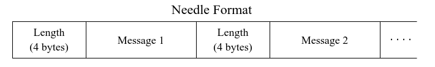

# Objective

TCP Stream messages don't necessarily coalesce into clean complete forms when sent across the network, they may be concatenated to another message, they may be only half the message that was sent. A simple way to fix this problem is to attach a 4 byte `length` value at the start of each message.

    

## API

Needle exposes to two very simple API calls

1. **`encode_message:`** Accepts `message` which is a `BencodeMap` as a parameter, turns the message into bytes and adds the length of the message to its front. This final byte string is returned, which can be transmitted from the TcpStream to any peer.
2. **`decode_message:`** Accepts `bytes` as a parameter which is a byte vector slice, decodes the bytes into a `BencodeMap` and returns that value for processing by the peer manager.   